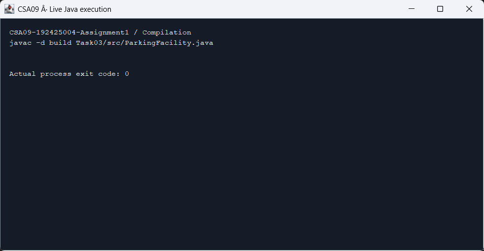
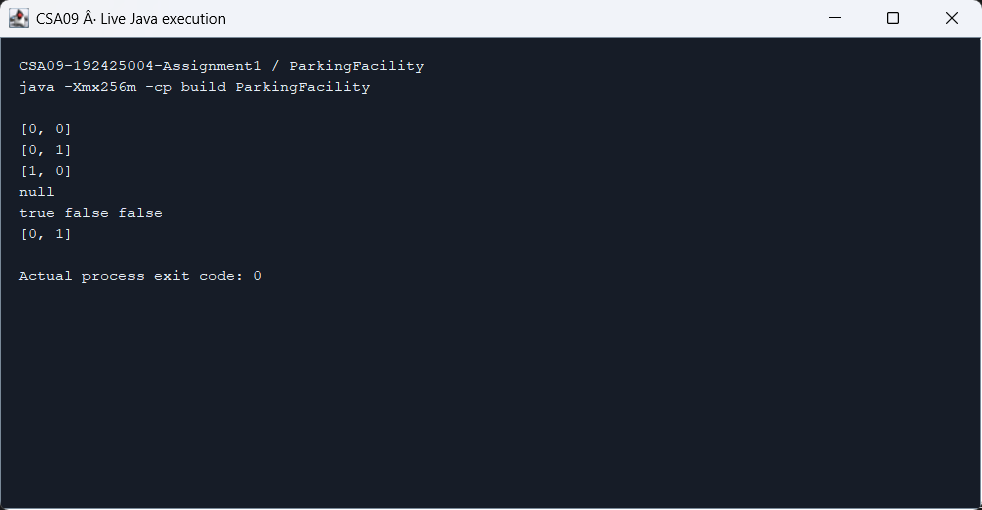

# Task03

[Written answers](ANSWERS.md) · [Test input](input/README.md)

Two floors with capacities 2 and 1. Four registration requests, an invalid and repeated release, then reallocation.

Build with the [repository instructions](../README.md), then execute from that repository root.

```powershell
java -cp build ParkingFacility
```

- [run.txt](evidence/run.txt)

## Genuine execution captures




