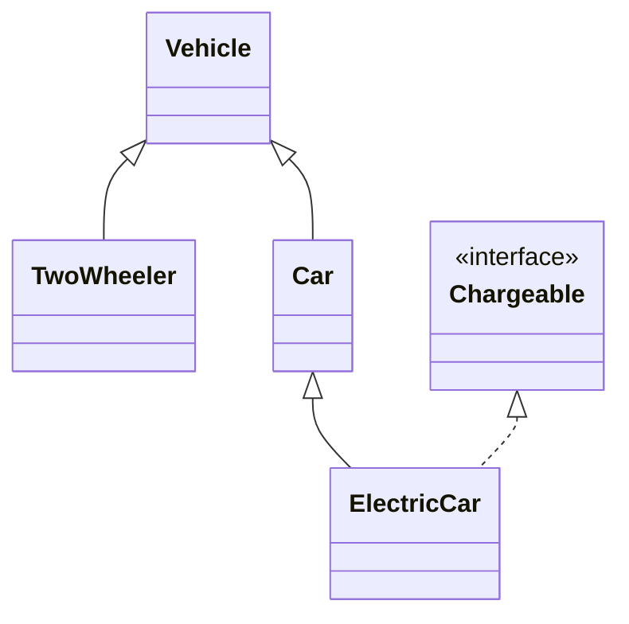

# Task 6 · Inheritance

Vehicle owns registration and shared billing arithmetic. Car contributes the car rate, TwoWheeler contributes its rate and ElectricCar inherits car parking behavior and adds charging. Vehicle has a hierarchical set of subclasses. ElectricCar uses multilevel single inheritance. On new ElectricCar, ElectricCar calls Car via super(registration), Car calls Vehicle, Vehicle's constructor initializes registration, then Car's body completes, then ElectricCar's body completes. Super can invoke accessible base methods or resolve accessible base fields; private registration is read through the accessor. Pass eligibility models variations in membership without adding user subclasses.

A composition alternative constructs Vehicle(registration, ratePolicy) and delegates hours and time to ratePolicy.quote. A new fixed rate can be configured as data, while new timed behavior adds a policy. An inheritance design adds a subclass and any registration in the application factory. Both have O(1) fixed-rate fee work and O(1) per vehicle, with composition adding one per-object reference and allowing policy instances to be shared.
