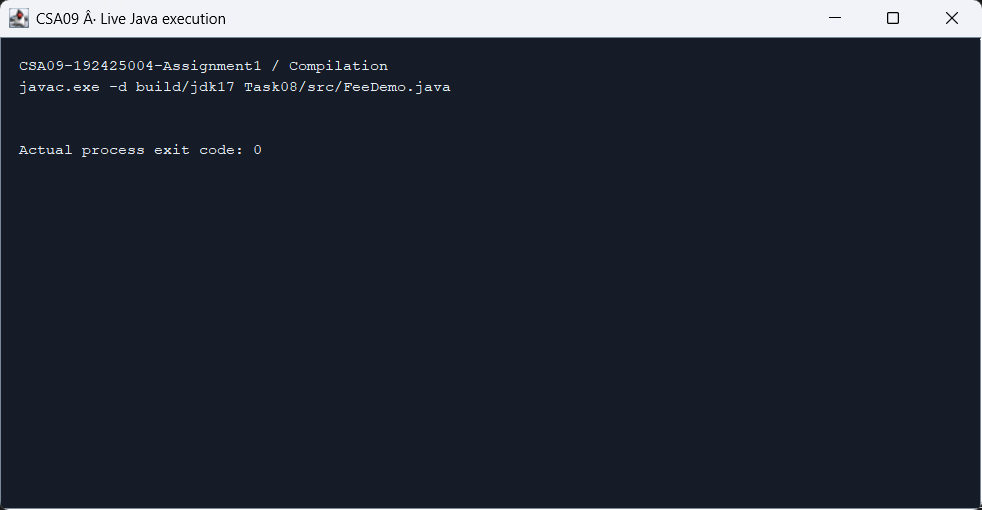
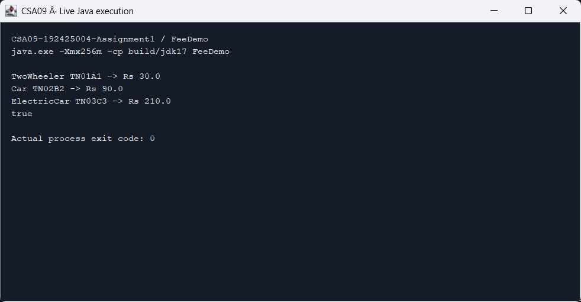
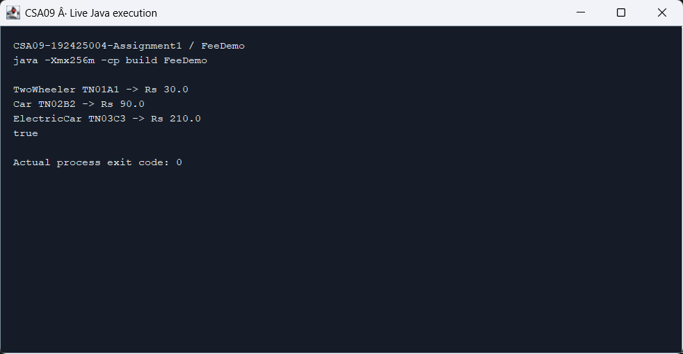
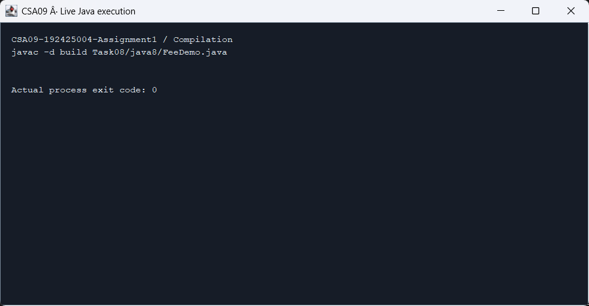

# Task08

[Written answers](ANSWERS.md) · [Test input](input/README.md)

Three vehicle types at 130 minutes and one EV charging 10 kWh. Two objects share TN02B2.

Build with the [repository instructions](../README.md), then execute from that repository root.

```powershell
java -cp build FeeDemo
```

- [java8-run.txt](evidence/java8-run.txt)
- [jdk17-run.txt](evidence/jdk17-run.txt)
- [jdk17-version.txt](evidence/jdk17-version.txt)

## Genuine execution captures








