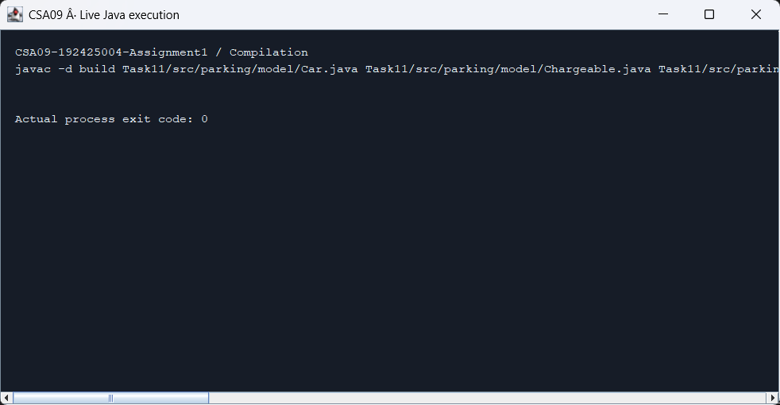
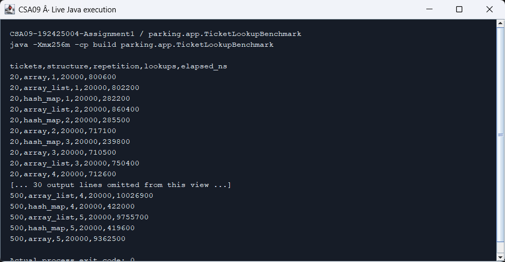
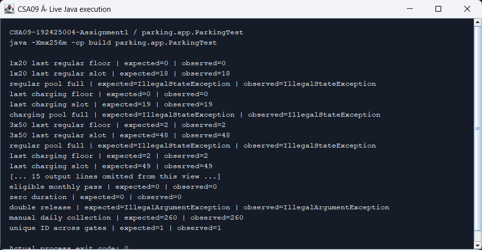

# Task11

[Written answers](ANSWERS.md) · [Test input](input/README.md)

Facilities 1×20, 3×50, 5×100, invalid and duplicate operations, and a daily collection of INR 260. Lookup seed 31.

Build with the [repository instructions](../README.md), then execute from that repository root.

```powershell
java -cp build parking.app.ParkingTest
java -cp build parking.app.TicketLookupBenchmark
```

- [lookup.csv](evidence/lookup.csv)
- [medians.md](evidence/medians.md)
- [tests.txt](evidence/tests.txt)

## Genuine execution captures






