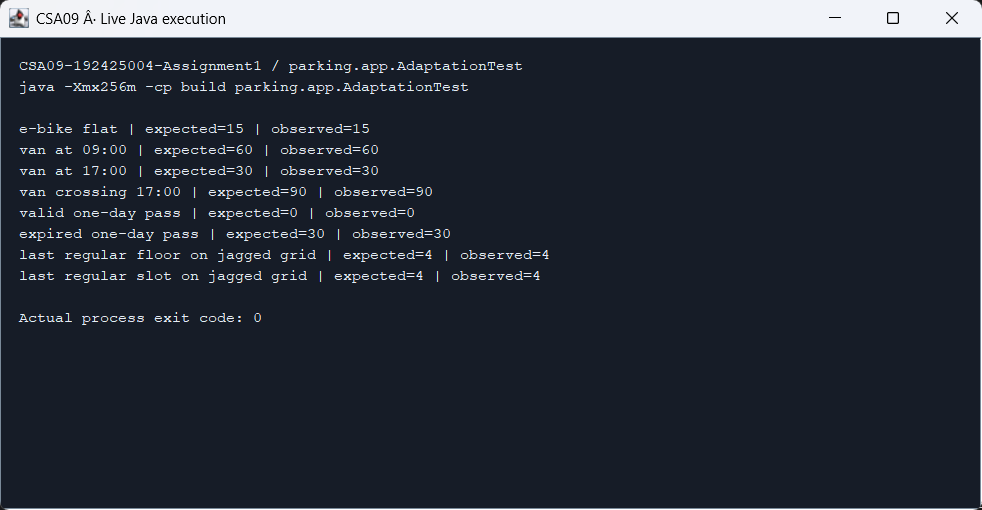
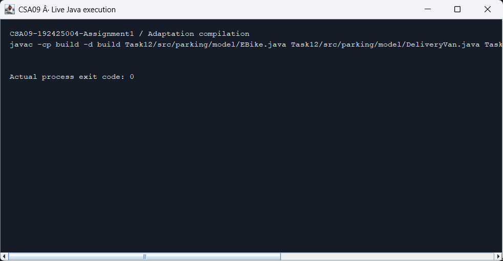

# Task12

[Written answers](ANSWERS.md) · [Test input](input/README.md)

Unequal floors 2,3,4,5,6, e-bike and van timing, valid and expired visitor passes.

Build with the [repository instructions](../README.md), then execute from that repository root.

```powershell
java -cp build parking.app.AdaptationTest
```

- [tests.txt](evidence/tests.txt)

## Genuine execution captures




