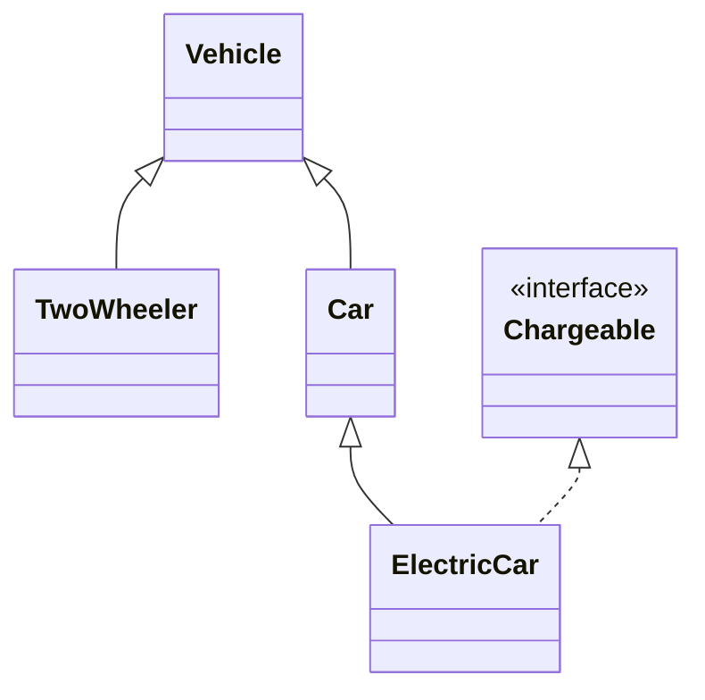
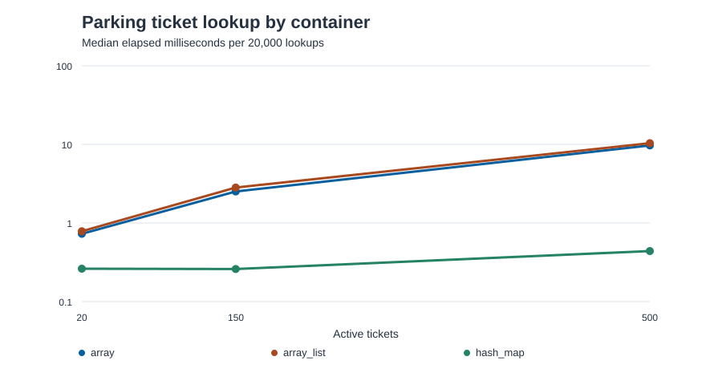

# CSA09 Programming in Java · Assignment 1

Design, Implement and Validate an Object-Oriented Model for a Campus Smart-Parking System

Aftan Faiz · 192425004 · CO1

GitHub repository [CSA09-192425004-Assignment1](https://github.com/AFTAN18/CSA09-192425004-Assignment1).

## Task01

### Task 1 · Problem analysis

Students, staff and visitors present vehicle registrations and any pass at the gate. The operator requests entry or exit, records charging use and checks collections. Entry consumes registration, type, entry time and charging request. It produces a ticket with a unique ID and an allocated floor/position, or a rejection. Exit takes the ticket reference, exit time and whole kWh and returns the fee and release confirmation.

| Candidate | Responsibility |
|---|---|
| Vehicle | Owns registration identity and supplies the hourly pricing behavior. |
| Facility | Owns the occupancy grid and guarantees exclusive allocation and valid release. |
| Ticket | Binds one entry event to the vehicle, coordinate and time. |
| Pass | Decides whether the customer is entitled to free parking at entry. |
| Slot | Holds occupancy and the charging capability so allocation can enforce eligibility. |
| Operator | Triggers gate operations. A separate operator object is unnecessary without authentication requirements. |

One vehicle has at most one active ticket per facility. A slot holds at most one ticket. Release requires its active ticket and an exit at or after entry. IDs are unique during the running process. An invalid or failed request changes no occupancy. Charging is billed separately and requires a charging slot. Assume zero-based indices, local campus timestamps, hourly rounding up, zero charge at zero duration and in-memory data. Lost tickets and durable IDs would require persistent storage.

With parallel arrays use the same occupied index for regNo, type and entryTime. Scan indices and return the first whose registration matches, or report absent. For n vehicles both a plain object array and parallel arrays take O(n) worst-case registration comparisons and O(1) auxiliary space. With registration length L, comparison can cost O(L). A keyed index adds O(n) space and gives expected constant lookup with bounded-length keys. Fixed fields cost O(1) space per vehicle in either layout. A new attribute adds one field to the class or one synchronized array with changes to insertion, deletion and reordering. Both add O(n) total field storage, and an object localizes the invariant.

## Task02

### Task 2 · Data representation

Use int for zero-based floor and slot indices, String for registrations (letters and leading zeroes matter), LocalDateTime for campus wall-clock entry and exit, long for elapsed minutes and long for integral rupee charges. This model assumes whole-rupee rates. Use minor currency units if fractional rates are introduced. Read complete lines with Scanner, parse integers explicitly and reject invalid dates and out-of-range coordinates. The executable fixture passes typed inputs directly so it is reproducible.

An int computation 61 / 60 is 1. A cast applied afterward only produces 1.0. A Rs 30 rate would therefore bill Rs 30 when Rs 60 is due. Use whole minutes divided by 60 plus one when the remainder is nonzero. At 60 minutes no extra hour is added.

Each floor has its own array. Given valid coordinates, a jagged array and ArrayList of arrays both look up a slot in O(1) and store O(N+F) entries and row references for N slots on F floors. Reserve a flat array of N slots and precompute offsets with offset[0] = 0 and offset[f+1] = offset[f] + count[f]. Index by offset[f] + slot after validating the local row bound. This also gives O(1) access and O(N+F) space. Multiplying by a uniform stride works for equal rows or padded rows, with O(F × maximum row length) space for padding. All use O(1) extra space per lookup.

## Task03

### Task 3 · Control logic

```text
ALGORITHM AllocateSlot(vehicle, requiresCharging)
    IF vehicle already has an active ticket THEN RETURN duplicate
    FOR EACH floor in ascending order DO
        FOR EACH slot in ascending order DO
            IF slot occupied OR slot incompatible THEN CONTINUE
            ASSIGN ticket and mark slot occupied
            RETURN ticket
        END FOR
    END FOR
    RETURN no suitable slot
END ALGORITHM

ALGORITHM ComputeFee(entry, exit, rate, eligiblePass, energy)
    IF exit precedes entry OR energy is negative THEN RETURN invalid input
    duration ← elapsed whole minutes
    hours ← duration DIV 60
    IF duration MOD 60 > 0 THEN hours ← hours + 1
    IF eligiblePass THEN parking ← 0
    ELSE parking ← hours × rate
    RETURN parking + energy × charging rate
END ALGORITHM
```

The ceiling separates a completed hour from the start of the next. No daily maximum is stipulated. A capped policy could apply MIN after calculating gross parking, before adding separately billed charging. A direct RETURN stops both search loops, whereas BREAK would leave only the inner loop. CONTINUE skips unusable positions. On exhaustion, the caller can display the full message or offer an alternate facility.

A free-slot stack per floor skips empty floors using their counts. Allocate by finding the first nonempty stack and popping its next slot. Release validates occupancy and pushes the released position. Use separate stacks for incompatible slot types. For F floors of S slots, scan costs O(FS) allocation and O(1) release with O(1) auxiliary space beyond the grid. Stacks cost O(F) allocation and O(1) release with O(FS+F) added space. LIFO changes the within-floor allocation order after a release. A min-heap preserves smallest-index ordering at O(log S) per floor update.

## Task04

### Task 4 · Constructors

Facility owns the jagged occupancy grid and provides enter, exit and collection operations. Vehicle owns a normalized registration and a rate hook. Ticket stores immutable ID, vehicle, entered time, floor and slot. A pass exposes an eligibility test. The ticket's constructor without a pass delegates to the pass-aware overload with this(...); the full constructor assigns and validates the fields. A zero-argument constructor would produce an incomplete ticket and is useful only for objects with meaningful defaults. A copy constructor is unnecessary. Reprinting uses existing immutable values and the same ID, while a new entry must mint a fresh ID.

A method-local reference commonly lives in a frame or register and refers to an object with heap semantics. The facility's grid also holds references. A static factory can validate first and then call a private constructor. A setter-based design must guard every use before all setters finish or expose only a validated builder result. Each approach costs O(n) time and O(n) retained space for n fixed-size tickets, with O(1) extra work and space per direct construction.

## Task05

### Task 5 · Static members

One AtomicLong counter in Ticket assigns IDs across all gates in a single JVM. A facility tracks occupancy independently. A global live count, if required, would need synchronization shared by those facilities. Static constants are assigned at declaration; a static initializer is suitable for a one-time setup of an immutable pricing table. A static helper such as billableHours uses only its input.

Java passes the reference value by value. Enter returns a reference to the same immutable ticket stored in the grid. Exit clears the grid reference. After the operator, caller and other collections stop referencing it, it becomes eligible for GC. The collection amount is tracked independently.

A per-facility counter starts at one for both gates, so use (gate ID, counter) as a composite ID if independent counters are required. A JVM-wide counter occupies O(1) space, regional counters O(k) across k facilities, and stored IDs O(n) across n tickets in either approach. For restart or multiple JVMs, use a durable shared sequence or unique facility prefix plus a persisted local counter.

## Task06

### Task 6 · Inheritance



Vehicle owns registration and shared billing arithmetic. Car contributes the car rate, TwoWheeler contributes its rate and ElectricCar inherits car parking behavior and adds charging. Vehicle has a hierarchical set of subclasses. ElectricCar uses multilevel single inheritance. On new ElectricCar, ElectricCar calls Car via super(registration), Car calls Vehicle, Vehicle's constructor initializes registration, then Car's body completes, then ElectricCar's body completes. Super can invoke accessible base methods or resolve accessible base fields; private registration is read through the accessor. Pass eligibility models variations in membership without adding user subclasses.

A composition alternative constructs Vehicle(registration, ratePolicy) and delegates hours and time to ratePolicy.quote. A new fixed rate can be configured as data, while new timed behavior adds a policy. An inheritance design adds a subclass and any registration in the application factory. Both have O(1) fixed-rate fee work and O(1) per vehicle, with composition adding one per-object reference and allowing policy instances to be shared.

## Task07

### Task 7 · Overriding

Car and TwoWheeler override ratePerHour because their base pricing differs. ElectricCar inherits the car base rate and implements Chargeable. The additional duration-based hook allows a time-aware tariff. Java overriding needs the same parameter signature, a compatible return type (covariant for reference types) and equal or wider access. An overriding method cannot widen checked exceptions. The Override annotation makes signature mismatches compile errors.

Registration is final because changing an identity inside a set breaks lookup. equals and hashCode are final on the integrated Vehicle class to keep symmetry across subclasses. Two normalized equal registrations compare equal and use the same String hash. toString prints the type and registration for diagnostics. The e-bike is final because it is the concrete flat tariff exemplar.

A switch on an enum delegates by case. A dense indexed jump table can be O(1), sparse lookup depends on compilation, and a sequential condition chain has O(k) worst-case tests for k kinds. Dynamic dispatch is modeled as O(1). Both use O(1) auxiliary space per fixed-rate call and O(k) type-specific code. The enum-switch design updates the type declaration and the pricing implementation, possibly in one class. A new subclass localizes pricing, and the application still needs a route that constructs it.

## Task08

### Task 8 · Polymorphism

The compiler selects calculateFee(int) for an integer argument and calculateFee(LocalDateTime, LocalDateTime) for two timestamps. In FeeDemo, the declared array component and loop variable type is Vehicle. For TN03C3 the runtime class is ElectricCar, which inherits Car.ratePerHour. calculateFee bills three hours at Rs 30. The Chargeable check adds 10 × Rs 12, totaling Rs 210. equals compares registrations across Vehicle subtypes, so two objects representing TN02B2 are equal. This is appropriate when one normalized registration identifies one vehicle in the modeled facility.

An instanceof implementation must check ElectricCar before Car because an electric car also satisfies the car test. A chain of k candidate types has O(k) worst-case checks and O(k) centralized branches. A virtual call uses modeled O(1) dispatch and O(1) call space. Baseline pricing avoids a type chain, and the capability check is for optional charging.

The original snippet uses the Java 16+ instanceof binding in main. The Java 8 variant mechanically uses an explicit cast at that line. Expected output is in tests/expected.txt.

## Task09

### Task 9 · Abstraction

Vehicle is abstract because it shares registration state, equality and the billable-hours calculation and requires the concrete type to expose its rate. Chargeable represents a capability independent of family. ElectricCar can inherit Car and implement Chargeable and additional interfaces, such as a reporting capability. An interface default method can quote a fixed tariff from an abstract rate accessor. An interface static helper can validate nonnegative kWh at a common boundary.

In the reverse design Vehicle can expose getRegistration and ratePerHour and supply an interface default fee method. An abstract ChargeableVehicle can own charging state. Interfaces have no instance fields or constructors, so each implementing branch needs its own identity state or a separate delegate. A charging class cannot also extend an independent Car class, so use composition or move Car behind an interface. Virtual and interface dispatch are both modeled as O(1), with unchanged O(1) per-instance storage order and possible extra delegation references.

## Task10

### Task 10 · Encapsulation

parking.model contains Vehicle, Pass and Ticket, parking.service owns Facility and its occupancy state, and parking.app runs tests and demonstrations. Private fields protect array contents and identity. Public accessors expose immutable ticket values and the service's operations. Protected pricing hooks allow vehicle subtypes to specialize. Package-private helpers are useful for implementation collaborators. The program validates coordinates at the service boundary and rejects negative duration, nonpositive floor sizes and invalid charging use. No setter exposes the occupancy grid or an unvalidated ticket update.

Collections such as Map<String, Long> box long values. Use numeric comparison after checked unboxing or equals for wrapped values. Integer == compares reference identity and can give surprising results outside cached values. Unboxing null throws.

With public fields, every caller must validate bounds and coordinate consistency before mutating a slot. Bounds checks are O(1) in either design, while c mutating call sites can duplicate O(c) validation code and allow a caller to bypass it. The encapsulated version centralizes checks and uses O(1) auxiliary space per update.

## Task11

### Task 11 · Implementation and tests

The jagged occupancy grid holds immutable tickets. Vehicle's pricing template uses an overridden rate and Chargeable adds a second invoice component. Package boundaries hide slot writes. Daily collections capture the exit date. The scenario collection is Rs 30 (car at exactly 60 minutes) + Rs 20 (bike at 61 minutes) + Rs 210 (EV at 130 minutes with 10 kWh) + Rs 0 (eligible staff) + Rs 0 (zero-minute stay) = Rs 260. See evidence/tests.txt for asserted input-specific expected and observed results. A charging reservation means each floor has one fewer regular slot. The tests fill both pools separately across 20, 150 and 500 physical slots.

The facility is in-memory and loses ticket state after a restart. Entry scans all N slots to reject duplicate registrations. The supplied position and ticket ID make the core exit O(1) in slot work, and the daily collections update is expected O(1). An exit that only knows a registration must search. With an array or ArrayList, scan and compare registrations, then use the located coordinate to release. Both take O(n) worst-case comparisons and O(n) references. An array has fixed capacity, and an ArrayList grows amortized O(1) per append but middle deletion shifts a suffix in O(n). A HashMap uses expected O(1) lookup with bounded-length keys and good distribution, O(n) retained memory with extra buckets and entries, and can degrade with collisions. Each lookup needs O(1) temporary space. A concurrent change must update occupancy and any map index together.

The benchmark uses seeded successful lookups, 20,000 per sample, three warmups and five measured samples per structure and size. Keys and containers are constructed before timing. An accumulated ID verifies that each structure answers the same requests and keeps work observable. Raw measurements and a median table are in evidence. This microbenchmark excludes construction, deletion and misses. The grid remains useful for slot assignment. For scan-heavy registration exits, retain the grid and add an index if the memory and update costs are acceptable.

## Task12

### Task 12 · Adaptation

#### A. Impact analysis

Add an e-bike with a flat Rs 15 rate (assumed because the prompt supplies no amount), a van, a one-day visitor entitlement and configuration for five unequal floors. The fee hook, pass eligibility and boot configuration are the affected responsibilities. A rectangular array would require padding or a migration. The Facility already consumes a jagged shape, so the tested array logic works with sizes 2, 3, 4, 5 and 6.

#### B. Evaluation

The base timestamp quote is factored into Vehicle, and the hourly rates live with each subclass. This is straightforward for the three original types. Timestamp-based tariff extensions need the quote hook plus a known time rule. The minutes-only overload in the base class is supplied for fixed-hour tariffs and lacks the wall-clock information the van needs. The service always uses the timestamp path.

#### C. Adaptation

Extend Vehicle with the EBike and DeliveryVan subclasses and implement Pass as VisitorDayPass. A visitor pass is assumed prepaid and covers entries on its named calendar date, with parking validated at entry. The e-bike fee is per stay. Price each started van hour according to the start of that hour, with peak interval [09:00, 17:00). This defines the crossing-boundary behavior explicitly. If the policy requires prorating by minute, the tariff needs different rounding rules. A flat fee is O(1) time and an h-hour van stay takes O(h) time and O(1) extra space. Grouping complete days and counting intersections of hourly starts with peak ranges can reduce the timed quote work.

#### D. Defence

The extension adds three model classes and an executable test without edits to the baseline Vehicle, Ticket, Pass or Facility sources. An application factory or menu would register new constructor choices. The regular allocation and exit contracts remain exercised by the original test suite. The added test asserts a flat e-bike price, both peak bounds, a crossing, valid and expired passes and the final regular slot on the fifth floor. See evidence/tests.txt. The design centralizes occupancy while distributing tariff behavior. A composable policy would help if rates must be swapped dynamically across fleets.

## Completion checklist

- [x] Tasks 01–12 written and committed.
- [x] Task03 and Java 8 Task08 match the expected output.
- [x] Original system and extension execute successfully.
- [x] Raw lookup timings captured.
- [x] Compiled the original Task08 with Temurin 17.0.21 and verified all four output lines.
- [x] Captured genuine execution PNGs and verified the published repository link.


## Measured comparisons


